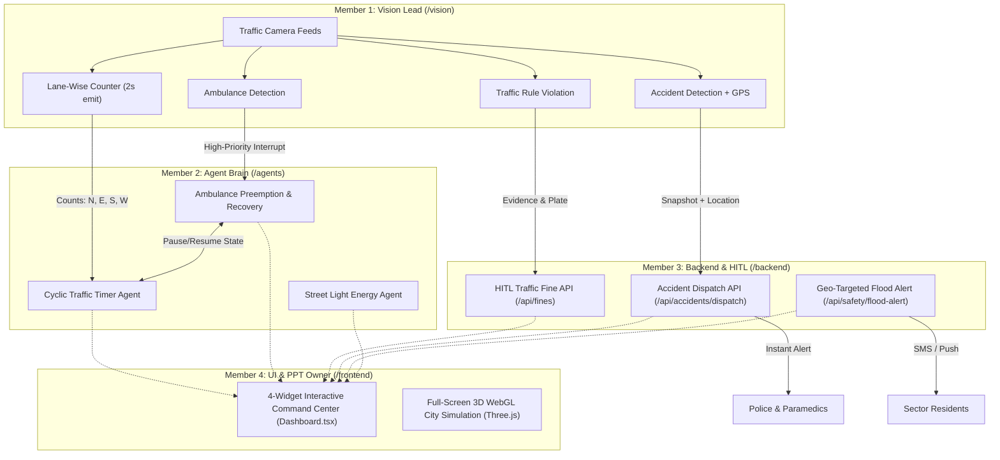

# 🚦 Team Mirai — Smart City Multi-Agent Platform
### Problem Statement 4: Autonomous Traffic Management, Public Safety & Energy Optimization

---

## 🏙️ Executive Overview

The **Team Mirai Smart City Platform** is a multi-agent autonomous infrastructure system engineered to resolve urban intersection bottlenecks, guarantee immediate priority for emergency vehicles, provide human-in-the-loop (HITL) fine governance, and optimize municipal street lighting energy consumption through ambient lux responsiveness.

The platform is divided across 4 specialized member domains:
* **Member 1 (Vision Lead)** — `/vision`: Edge camera perception, lane counting, ambulance interrupt detection, accident tracking, and violation capture.
* **Member 2 (Agent Brain)** — `/agents`: Dynamic density-adaptive cyclic signal timing, out-of-order ambulance preemption & memory-state recovery, and daylight energy optimization.
* **Member 3 (Backend & HITL)** — `/backend`: Emergency accident dispatch API, single-human fine verification queue, and geo-targeted mass flood notification engine.
* **Member 4 (UI Command Center)** — `/frontend`: High-fidelity 3D WebGL city simulation (Three.js) and 4 synchronized operational dashboard widgets (`Dashboard.tsx`).

---

## 🏛️ System Architecture



---

## 📂 Repository Structure

```text
├── agents/                       # Member 2: Autonomous Decision & Control
│   ├── schemas.py                # Pydantic structured schemas for signals, interrupts & energy
│   ├── cyclic_timer_agent.py     # Dynamic green calculation & strict cyclic sequence
│   ├── ambulance_preemption_agent.py # Step 1 (Interrupt), Step 2 (Preempt), Step 3 (Resume)
│   ├── natural_light_energy_agent.py # Ambient daylight lux thresholds & energy saved (%)
│   ├── main.py                   # Agent brain orchestrator runner
│   └── requirements.txt          # Python dependencies
│
├── backend/                      # Member 3: Backend Services, Dispatch & HITL
│   ├── main.py                   # FastAPI app with accident dispatch & HITL fine endpoints
│   ├── database.py               # SQLite schema (fines, accidents, residents, flood alerts)
│   ├── smart_city.db             # Initialized SQLite database
│   └── requirements.txt          # Backend dependencies
│
├── vision/                       # Member 1: Edge Perception & Computer Vision
│   ├── traffic_perception.py     # Lane counter, ambulance trigger, accident & violation logic
│   └── requirements.txt          # YOLOv8, OpenCV, Google GenAI dependencies
│
├── frontend/                     # Member 4: 3D Simulation & Command Center Dashboard
│   ├── src/
│   │   ├── simulation/
│   │   │   └── CitySimulation.ts # High-graphics Three.js city, traffic physics & lighting
│   │   ├── components/
│   │   │   ├── Widget1IntersectionTimer.tsx # 4-way countdowns & preemption status
│   │   │   ├── Widget2HITLFineReview.tsx     # Single-human fine verification queue
│   │   │   ├── Widget3ControlAndFloodFeed.tsx # Accident dispatch & mass flood broadcast
│   │   │   ├── Widget4StreetLightEnergy.tsx   # Daylight slider & live energy saving gauge
│   │   │   └── SimulationControlPanel.tsx     # Vehicle speeds, lane density, camera modes
│   │   ├── Dashboard.tsx         # Unified Command Center UI
│   │   ├── App.tsx
│   │   ├── main.tsx
│   │   └── index.css             # Glassmorphism & Midnight Stealth / Electric Cyan styling
│   ├── package.json
│   ├── vite.config.ts
│   └── tailwind.config.js
│
├── Roles/                        # Original specification references & diagrams
├── SYSTEM_REQUIREMENTS.md        # Master specification & exact mathematical formulas
└── README.md
```

---

## ⚡ Quick Start Guide

### 1. Frontend 3D Command Center
```bash
cd frontend
npm install
npm run dev
```
Open [http://localhost:3000](http://localhost:3000) in your browser. The frontend includes a standalone fallback simulator, allowing all 3D features, sliders, widgets, and buttons to work out of the box even before backend services are started.

### 2. Backend & Agent Services
```bash
# Terminal 1: Start Backend API
cd backend
pip install -r requirements.txt
python -m uvicorn backend.main:app --host 0.0.0.0 --port 8000 --reload

# Terminal 2: Run Agent Brain
cd agents
pip install -r requirements.txt
python -m agents.main

# Terminal 3: Run Vision Perception
cd vision
pip install -r requirements.txt
python -m vision.traffic_perception
```

---

## 📐 Formulas & Core Logic

### 1. Dynamic Cyclic Green Duration (Member 2)
$$\text{Green Time} = \min\big(60\text{s}, \max(15\text{s}, 10\text{s} + 2\text{s} \times \text{Vehicle Count})\big)$$
* **Minimum safety duration**: 15 seconds.
* **Maximum green duration**: 60 seconds.
* **Order**: Strictly cyclic (`North → East → South → West → North`) without lane skipping.

### 2. 3-Step Ambulance Preemption & Recovery (Member 2)
1. **Interrupt**: Capture and store active cycle state in memory (`paused_lane`, `remaining_time`).
2. **Preempt**: Turn all non-emergency lanes `Red`; switch ambulance lane to `Green`.
3. **Resume**: Upon intersection clearance, restore `paused_lane` with its remaining seconds and continue normal cyclic sequence.

### 3. Natural-Light Street Light Dimming (Member 2)
* **Bright Sunlight ($> 70\%$)**: Power set to `0%` (OFF).
* **Cloudy / Storm / Twilight ($30\% - 70\%$)**: Scaled inversely between `30%` and `70%` brightness ($\text{Power} = 100 - \text{Daylight}$).
* **Darkness / Night ($< 30\%$)**: Power set to `80% - 100%`.
* **Energy Saved**: $\text{Energy Saved } (\%) = 100\% - \text{Street Light Power } (\%)$.

### 4. Human-in-the-Loop (HITL) Fines (Member 3)
* Zero automated fines are issued directly to citizens.
* Every violation must be overviewed and signed off by an authorized human officer via `POST /api/fines/{id}/verify`.
