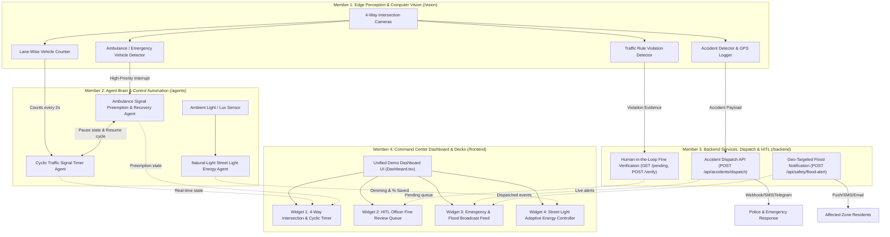

# Team Mirai — Smart City Multi-Agent Traffic & Public Safety System
## Master System Specification & Team Role Breakdown (Problem Statement 4)

---

## 🏛️ System Overview & High-Level Architecture

The system is an autonomous, multi-agent AI city infrastructure platform addressing three core domains:
1. **Traffic Management**: Lane-density adaptive cyclic signal timers, emergency vehicle preemption & cycle recovery, rule-violation detection.
2. **Public Safety**: Automated intersection accident detection with emergency dispatch, human-in-the-loop (HITL) fine verification, and geo-targeted mass flood emergency broadcasting.
3. **Energy Management**: Ambient natural-light adaptive street light dimming with real-time energy savings monitoring.



---

## 🗂️ Project Repository & Technology Stack Architecture

| Role | Domain / Title | Code Directory | Tech Stack & Dependencies | Key Deliverables |
| :--- | :--- | :--- | :--- | :--- |
| **Member 1** | **Vision Lead** | `/vision` | • Python 3.10+<br>• `ultralytics` (YOLOv8)<br>• `opencv-python`<br>• `google-genai` (optional frame analysis) | • 4-camera lane counter (2s interval)<br>• Ambulance / EV interrupt detector<br>• Accident frame analyzer + GPS<br>• Red light / helmet / wrong-way violation detector |
| **Member 2** | **Agent Brain** | `/agents` | • Python 3.10+<br>• `langgraph` or `asyncio` state machine<br>• `pydantic` (structured schemas) | • Cyclic signal timer (dynamic duration formula)<br>• Ambulance preemption & recovery interrupt agent<br>• Ambient lux / daylight adaptive street light controller |
| **Member 3** | **Backend & HITL** | `/backend` | • Python 3.10+<br>• `fastapi`, `uvicorn`, `websockets`<br>• `sqlite3` or `Firebase Firestore` | • Control forces accident dispatch API (`POST /api/accidents/dispatch`)<br>• HITL traffic fine review endpoints (`GET /api/fines/pending`, `POST /api/fines/{id}/verify`)<br>• Geo-targeted flood alert microservice (`POST /api/safety/flood-alert`) |
| **Member 4** | **UI & PPT Owner** | `/frontend`<br>& presentations | • Node.js (v20+)<br>• React + TypeScript + Vite + Tailwind CSS<br>• Canva / PowerPoint | • Unified 4-Widget Command Center UI (`Dashboard.tsx`)<br>• 100% of Round I & Round II PPT Decks (10 slides) |

---

## 👥 Detailed Role & Module Breakdown

### 🎯 Member 1: Vision Lead (`/vision`)
* **Tech Stack**: Python 3.10+, `ultralytics` (YOLOv8), `opencv-python`, `google-genai` (optional multimodal frame analysis)

#### 1. Lane-Wise Traffic Counter (For Cyclic Time Alteration)
* **Objective**: Reads 4 camera feeds (`North`, `East`, `South`, `West` lanes at an intersection) from the traffic light cameras and counts waiting vehicles per lane using YOLO / OpenCV.
* **Frequency & Format**: Emits counts every **2 seconds** to Member 2's cyclic signal agent.
* **Payload Specification**:
  ```json
  {
    "north": 19,
    "east": 4,
    "south": 11,
    "west": 3
  }
  ```

#### 2. Ambulance & Emergency Vehicle Detector
* **Objective**: Real-time detection trigger identifying an approaching ambulance or emergency vehicle in any incoming lane.
* **Behavior**: Immediately fires a high-priority interrupt payload directly to Member 2's preemption agent so the signal opens for that lane regardless of normal cycle order.
* **Payload Specification**:
  ```json
  {
    "emergency_vehicle": true,
    "type": "ambulance",
    "lane": "east"
  }
  ```

#### 3. Intersection Accident Detector
* **Objective**: Vision model or multimodal Gemini API frame analyzer detecting accidents near traffic lights (crashed, overturned, or stalled colliding vehicles).
* **Behavior**: Extracts snapshot frame, attaches intersection GPS coordinates and name, and sends payload to Member 3's notification dispatcher.
* **Payload Specification**:
  ```json
  {
    "accident_detected": true,
    "location": "Junction 4 - Main Rd (13.556° N, 80.026° E)",
    "snapshot": "frame_04.jpg"
  }
  ```

#### 4. Traffic Rule Violation Detector
* **Objective**: Checks traffic compliance (crossing stop-line on red light, riding without helmet, driving wrong-way).
* **Behavior**: Packages violation metadata, plate OCR, and snapshot evidence image, and enqueues to Member 3's human review queue.
* **Payload Specification**:
  ```json
  {
    "violation": "Red Light Jump",
    "vehicle_plate": "AP-39-BK-4021",
    "fine_amount": 1000,
    "evidence_image": "violation_12.jpg"
  }
  ```

---

### 🧠 Member 2: Agent Brain (`/agents`)
* **Tech Stack**: Python 3.10+, `langgraph` or `asyncio` state machine, `pydantic` (structured schemas)

#### 1. Cyclic Traffic Signal Timer Agent
* **Objective**: State-machine agent rotating green lights strictly in cyclic order (`North → East → South → West → North`) while dynamically calculating green duration per lane based on vehicle count.
* **Strict Invariants**: Never skips a lane during normal operation; order remains cyclic.
* **Dynamic Green Time Formula**:
  $$\text{Green Time} = \min\big(60\text{s}, \max(15\text{s}, 10\text{s} + 2\text{s} \times \text{Vehicle Count})\big)$$
  * *Minimum green*: $15\text{s}$
  * *Maximum green cap*: $60\text{s}$
  * *Scaling*: $10\text{s} \text{ base} + 2\text{s} \text{ per detected vehicle}$

#### 2. Ambulance Signal Preemption & Recovery Agent
* **Objective**: Autonomous interrupt controller listening for Member 1's ambulance detection payload.
* **3-Step Execution Workflow**:
  1. **Step 1 (Interrupt)**: The moment an ambulance is detected (e.g. `West`), immediately snapshot and store the current cycle state in memory:
     ```json
     {
       "paused_lane": "North",
       "remaining_time": 18
     }
     ```
  2. **Step 2 (Preempt)**: Immediately force all other lanes to `Red` and transition the ambulance's lane (`West`) to `Green`, bypassing regular cyclic order.
  3. **Step 3 (Resume Normal Cycle)**: As soon as camera perception confirms the ambulance has cleared the intersection, restore `paused_lane` (`North`) with its remaining `18s` and proceed with the normal cyclic sequence.

#### 3. Natural-Light Street Light Energy Management Agent
* **Objective**: Dynamically regulates street lighting intensity according to natural ambient daylight (lux sensor / live weather data).
* **Control Thresholds**:
  * **Bright Natural Light ($> 70\%$ daylight)**: Street lights set to **$0\%$ power (OFF)**.
  * **Cloudy / Storm / Twilight ($30\% - 70\%$ daylight)**: Street lights scale inversely between **$30\%$ and $70\%$ brightness**.
  * **Darkness / Night ($< 30\%$ daylight)**: Street lights set to **$80\% - 100\%$ brightness**.
* **Metric Output**: Continuously computes and broadcasts `Energy Saved (%)` for the dashboard.

---

### 🛡️ Member 3: Backend & HITL (`/backend`)
* **Tech Stack**: Python 3.10+, `fastapi`, `uvicorn`, `websockets`, `sqlite3` or `Firebase Firestore`

#### 1. Control Forces Accident Notification API
* **Endpoint**: `POST /api/accidents/dispatch`
* **Trigger**: Triggered automatically upon Member 1 accident detection.
* **Action**: Dispatches instant alerts (Telegram Bot API, Twilio SMS, or Webhook) to emergency forces (police/paramedics) including:
  * Exact GPS coordinates & location name
  * Clickable Google Maps pin link
  * Timestamp
  * Camera snapshot frame URL

#### 2. Human-in-the-Loop (HITL) Traffic Fine Overview System
* **Guaranteed Policy**: Zero automated penalties. Every fine must receive single-human verification before an official notice is issued.
* **Database & Endpoints**:
  * `GET /api/fines/pending`: Returns queue of all AI-detected rule violations awaiting review.
  * `POST /api/fines/{fine_id}/verify`: Accepts review action:
    ```json
    { "action": "APPROVE" } // or { "action": "REJECT" }
    ```
    * If approved: Generates digital fine receipt and registers reviewing officer's ID & timestamp.
    * If rejected: Marks violation discarded with audit log.

#### 3. Public Safety Geo-Targeted Flood Notification Engine
* **Endpoint**: `POST /api/safety/flood-alert`
* **Trigger**: Water-level sensor threshold breach across city sectors (`Sector A`, `Sector B`, `Sector C`).
* **Action**: Queries resident database filtering users registered in the affected sector, broadcasting immediate multi-channel alerts (Push, SMS, Email):
  > *"FLOOD ALERT: Rising water detected in Sector B. Move to higher ground immediately."*

---

### 💻 Member 4: UI & PPT Owner (`/frontend` & Presentations)
* **Tech Stack**: Node.js (v20+), `React + TypeScript + Vite + Tailwind CSS`, Canva / PowerPoint

#### Deliverable A: 100% of Round I & Round II PPT Decks (10 Slides)
1. **Slide 1**: Title, Team Mirai, & Problem Statement 4 Overview.
2. **Slide 2**: Problem Breakdown across Traffic Management, Public Safety, and Energy Management.
3. **Slide 3**: Master Multi-Agent Architecture Diagram connecting Camera Perception, Agent Brain, HITL Guardrail, and Public Alerting.
4. **Slide 4**: Deep-dive flowchart on Cyclic Traffic Time Alteration + Ambulance Out-of-Order Signal Preemption & Normal Recovery.
5. **Slide 5**: Intersection Accident Dispatch (with Location to Control Forces) & Human-Overview Traffic Fine Workflow.
6. **Slide 6**: Public Safety Module: Geo-targeted flood notification system alerting every person in the affected area.
7. **Slide 7**: Energy Management Module: Adaptive street lighting controlled by natural ambient light levels.
8. **Slide 8**: Tech Stack & Real-Time Demo Flow.
9. **Slide 9**: Command Center UI Screenshots & Human-in-the-Loop Governance.
10. **Slide 10**: Quantified City Impact (faster emergency clearance, rapid accident dispatch, zero false fines, mass flood safety, and power savings).

#### Deliverable B: Command Center Web Dashboard UI (`Dashboard.tsx`)
1. **Widget 1 — Live 4-Way Intersection & Cyclic Timer**:
   * Visualizes North, East, South, West traffic lights.
   * Dynamic vehicle counts & countdown timers rotating cyclically.
   * Interactive button: `[Simulate Ambulance in East Lane]` (triggers preemption to Green, then resumes previous paused lane).
2. **Widget 2 — Human Officer Fine Overview Queue**:
   * Displays violation evidence photo, license plate OCR, infraction type, and fine amount.
   * Action buttons: `[Approve Fine]` and `[Reject]` to demonstrate HITL compliance.
3. **Widget 3 — Control Forces & Flood Broadcast Feed**:
   * Live dispatch log for accident notifications with location pin links.
   * Interactive button: `[Trigger Flood in Zone B]` displaying real-time mass alert broadcast count and resident notification status.
4. **Widget 4 — Natural-Light Street Light Controller**:
   * Interactive daylight slider (`0% Night` to `100% Sunny`).
   * Visual lamp icons dimming/brightening in real-time with dynamic `Energy Saved (%)` counter.
